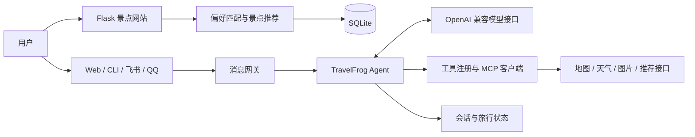

# TravelFrog · 智能旅行规划助手


结合多轮对话、景点推荐与地图天气工具的旅行规划应用。用户可以在网站中设置出行偏好，也可以通过对话补充目的地、天数与同行人数，获取旅行建议。

[功能特性](#功能特性) · [系统架构](#系统架构) · [快速开始](#快速开始) · [配置指南](docs/configuration.md) · [开发指南](docs/development.md)

## 功能特性

| 模块 | 功能 |
| --- | --- |
| 旅行 Agent | 多轮需求收集、旅行状态管理、工具调用与会话持久化 |
| 个性化推荐 | 根据季节、风格、预算、天数及同行人群等偏好进行城市与景点匹配 |
| 外部工具 | 通过 MCP 连接高德地图、心知天气与景点图片服务 |
| 用户网站 | 注册登录、景点详情、收藏、评论与个人中心 |
| 管理后台 | 景点维护、用户与推荐记录管理 |
| 交互渠道 | Web、命令行、飞书与 QQ |

## 系统架构



网站与 Agent 为两个独立进程，默认分别使用 `5001` 和 `8081` 端口。Agent 基于 NanoClaw 的执行循环，业务能力通过工具与 MCP 服务扩展。

## 技术栈

- **Agent**：Python、异步消息网关、OpenAI 兼容模型接口、MCP。
- **Web**：Flask、HTML/CSS/JavaScript。
- **数据**：SQLite、JSONL 会话记录。
- **渠道**：Web、飞书与 QQ SDK。

## 快速开始

### 1. 获取项目

```bash
git clone https://github.com/chuantiet5-stack/travelfrog-ai-travel-planner.git
cd travelfrog-ai-travel-planner
```

建议为两个子项目分别建立 Python 虚拟环境，操作方式见[开发指南](docs/development.md)。

### 2. 启动景点网站

```bash
cd travel-recommend-system-main
python -m pip install -r requirements.txt
python init_db.py
python app.py
```

访问 <http://127.0.0.1:5001>。数据库与初始景点由 `init_db.py` 创建。

### 3. 启动旅行助手

在另一个终端，从仓库根目录执行：

```bash
cd TravelFrog
python -m pip install -r requirements.txt
python -c "import shutil; shutil.copyfile('config.example.json', 'config.json')"
```

编辑 `config.json`，填写 `api_key`、模型名称及所需的地图和天气凭证，再启动：

```bash
python main.py
```

访问 <http://127.0.0.1:8081>。飞书与 QQ 需配置各自的应用凭证；不使用时保持为空。

## 项目结构

```text
.
├── TravelFrog/                    # 旅行 Agent 服务
│   ├── agent/                     # 执行循环、上下文、记忆与工具
│   ├── bus/                       # 消息队列
│   ├── channels/                  # Web、CLI、飞书与 QQ 渠道
│   ├── mcp_servers/               # 地图、天气与图片工具服务
│   ├── providers/                 # 模型接口适配
│   ├── session/                   # 会话与旅行状态
│   ├── config.example.json
│   └── main.py
├── travel-recommend-system-main/   # 景点推荐网站
│   ├── recommendation/            # 候选筛选、匹配评分与权重
│   ├── static/                    # CSS 与 JavaScript
│   ├── templates/                 # 用户与管理页面
│   ├── tests/                     # 网站与推荐逻辑测试
│   ├── init_db.py
│   └── app.py
└── docs/                          # 配置与开发文档
```

## 文档

- [配置与服务接入](docs/configuration.md)：模型、地图、天气、渠道与网站环境变量。
- [开发与测试](docs/development.md)：开发环境、测试命令与代码阅读入口。
- [景点网站说明](travel-recommend-system-main/README.md)：网站功能与管理员初始化。

本地凭证与运行数据由 `.gitignore` 排除。配置从示例文件创建，勿将真实密钥写入源码。
